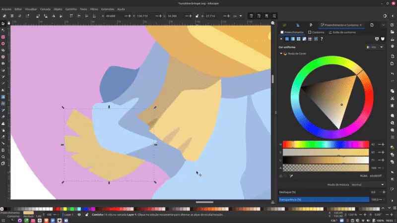

# 👋 Welcome to LoMDB

A lightweight, community-driven database for tracking and exploring merged servers, top players, and timelines across regions.

This project is built to help players, analysts, and enthusiasts get a clearer view of evolving server data, elite players, and historical merges, all in one place.

## 🚀 What You'll Find Here
📅 Merge Timelines

🌍 Regional Merge Lists (AM, EU, SEA)

📊 Tools for Visualizing and Comparing Data

## 🤝 Contributing
LoMDB is a collaborative effort. If you have ideas, data, or improvements to share, jump in! feel free to open an discussion.

**Thanks for being here. Let’s build something useful together!**